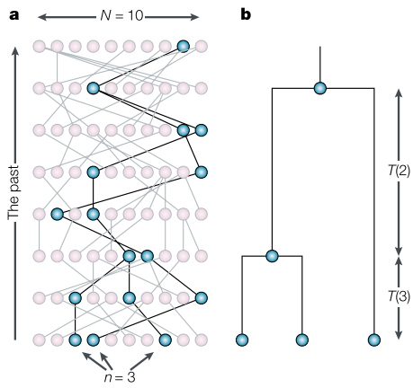
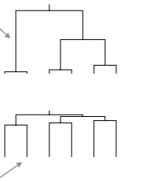
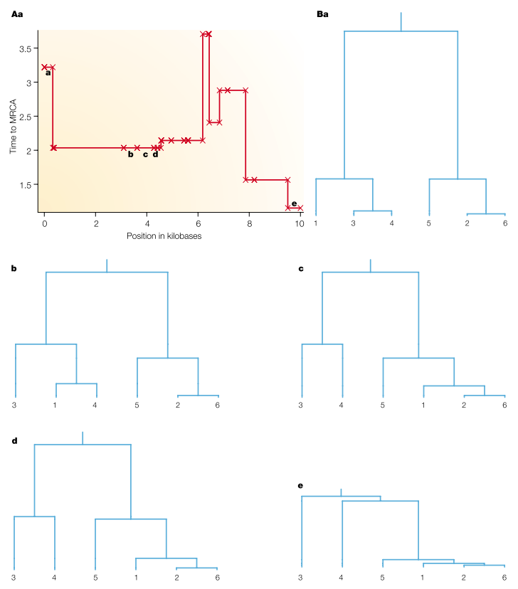

# Introduction

## Prerequisites

* R library ape
* R library scrm
```{R eval=FALSE}
# important for today
install.packages("ape")  # ape: reading, writing and plotting phylogenetic trees
install.packages("scrm") # scrm: a fast coalescent simulator (it uses the syntax of the classic program ms)
```

## Coalescent approximation:
Moving from trees maintaing the ancestry (remember our zigge-zagge trees) to more pretty trees. The idea is that the only peaces of interesting information are the time between coalescent events and the topology



\clearpage


The coalescent approximation is based on the following insights:

* Populations are large and only some k lineages are viewed; the probability that more than two lineages coalesce at the same time can be neglected
* the process of generating a topology can be separated from generating the branch length, i.e.: first a random topology can be generated and than random branch length (exponential distribution) can be drawn.

**major advantage of coalescent approximation: very fast**

## Topology



## Prerequisite: Trees
The R library ape supports printing trees in the Newick format (https://en.wikipedia.org/wiki/Newick_format)


Simplest tree
```{r}
library(ape)
tree <- read.tree(text="(A:2,B:2);")
plot(tree)
```

A bit more complex tree
```{r}
tree <- read.tree(text="((A:2,B:2):3,C:5);")
plot(tree)
```


```{r}
tree <- read.tree(text="(((A:2,B:2):3,C:5):15,D:20);")
plot(tree)
```


Adding a time axis

```{r}
tree <- read.tree(text="(((A:2,B:2):3,C:5):15,D:20);")
plot(tree)
axisPhylo()
```
In ape a tree is a list. the most important elements of the list are

```{r}
tree <- read.tree(text="(((A:2,B:2):3,C:5):15,D:20);")
tree$tip.label # names of tips
tree$edge 
# branches; each row connects a parent node to a child
# Tips are numbered 1 … n, internal nodes n+1 … . Let's add the numbers to the plot: 
tree$edge.length # the length of the branches
```
lets add numbers to the plot
```{r}
plot(tree)
nodelabels()
tiplabels()
edgelabels(tree$edge.length)
```
## writing trees to files; reading trees from files
```{r}
write.tree(tree,file="test.nwk")
getwd() # ok where did it save the tree?
tr2<-read.tree("test.nwk")
plot(tr2)
```


### Excercises 

#### build the following trees

```{r echo=FALSE}
tree <- read.tree(text="(((A:2,B:2):3,C:5):15,(E:3,D:3):17);")
plot(tree)
```

#### build the tree

```{r echo=FALSE}
tree <- read.tree(text="(((A:2,B:2):3,C:5):15,((E:1,F:1):2,(D:1,G:1):2):17);")
plot(tree)
```

#### change the branchlength and use the function is.ultrametric()
What is an ultrametric tree?

```{r}
is.ultrametric(tree)
```
# coalescent trees with ape
## random tree
```{r}
tr <- rcoal(10) # rcoal gives me a random tree
plot(tr);
axisPhylo()
```
## the SFS for a single tree
We could compute the expected SFS for every tree, eg if we perform infinite many simulations and random mutations. 
Much simpler lets assume infinite sites and infinite mutations; this removes the stochasticity of mutations;  
We can compute the exact SFS for every tree (e.g using infinite many mutations. )
We sum the length of all branches leading to singletons; the sum of all branches leading to doubletons etc
```{r}
branch_sfs <- function(tree) {
  n <- Ntip(tree)

  # number of tips below every node (a tip counts as 1, the root as n)
  # exercise: try it with a random tree; use nodelabels() and tiplabels()
  tips_below_node <- node.depth(tree, method = 1)

  # tree$edge = all branches
  # tree$edge= all child nodes (node below each parent)
  child_node <- tree$edge[, 2]

  # number of tips below each branch (actually below each child)
  # 1 ... singletons; every mutation on this branch is a singleton
  # 2 ... doubletons; every mutation on this branch is a doubleton
  tips_below_branch <- tips_below_node[child_node]

  # total branch length for each class: 1, 2, ..., n-1 tips below
  sfs <- numeric(n - 1)
  for (i in 1:(n - 1)) {
    is_class_i <- tips_below_branch == i ## which branches lead to singletons, doubletons etc (dependent on i)
    sfs[i] <- sum(tree$edge.length[is_class_i]) ## sum all branches leading to singletons doubletons (etc)
  }

  names(sfs) <- 1:(n - 1)
  sfs
}
tr <- rcoal(10)
par(mfrow = c(1, 2))
plot(tr)
barplot(branch_sfs(tr), xlab = "derived allele count", ylab = "branch length")
par(mfrow = c(1, 1))
```
## average SFS over many trees
```{R}
trees <- replicate(5000, branch_sfs(rcoal(10))) # lets simulate 5000 trees and compute the SFS
avg <- rowMeans(trees) # average the branch lengths (the SFS)
bp  <- barplot(avg, xlab = "derived allele count i", ylab = "mean branch length")
```

# scrm 
Coalescent simulations 

Setting up

```{R}
library(scrm)
set.seed(42)
```

how to call:

```
scrm("nsam nreps -t theta [other options]")
```
* nsam: number of DNA sequences
* nreps: how often should the simulations be repeated for the given set of parameters
* theta: amount of polymorphism $\theta=4N_e\mu$; Interestingly, we would get the same amount of polymorphism by either increasing the mutation rate or the effective population size. 

Why Theta?


## Minimal call 


```{R}
sim <- scrm("10 1 -t 5") 
# we sampled 10 sequences
# 1 replicate
# Theta is 5
sim
```

### the SFS of the segregating sites

```{R}
sfs <- function(seg) {
  n <- nrow(seg)                       # number of samples (rows = haplotypes)

  # derived allele count at each segregating site (columns = sites)
  derived_count <- colSums(seg)

  # just count 
  counts <- tabulate(derived_count, nbins = n - 1)
  names(counts) <- 1:(n - 1)
  return(counts)
}
s<-sfs(sim$seg_sites[[1]])
barplot(s, xlab = "derived allele count", ylab = "number of sites")
```

## Lets add a tree 

```{R}
sim <- scrm("10 1 -t 5 -T") 
tree <- read.tree(text = sim$trees[[1]])
plot(tree); 
axisPhylo()
```

### Idea! We could plot the expected SFS from the tree versus the actual SFS


```{R}
par(mfrow = c(1, 3))
plot(tree)
barplot(branch_sfs(tree), xlab = "derived allele count", ylab = "branch length")
barplot(sfs(sim$seg_sites[[1]]),       xlab = "derived allele count", ylab = "number of sites")
par(mfrow = c(1, 1))
```

**Question** why does it differ?


## One simulation gives a noisy SFS lets move to many simulations

```{r}
# 1000 simulations
sim <- scrm("10 1000 -t 5") 

mean_sfs <- function(sim) {
  sfs_for_each_sim<-sapply(sim$seg_sites, sfs) # lets compute the sfs for each simulation $seg_sites[[1]], $seg_sites[[2]] etc... 
 rm <-rowMeans(sfs_for_each_sim)   # average the SFS over all simulations
 return(rm)
}

ms <- mean_sfs(sim)
bp <- barplot(ms, xlab = "derived allele count i", ylab = "mean number of sites")
```

**Exercise**: compute the SFS of the tree for 1000 simulations

**Exercise**: does the SFS change with different Theta?

```{r, echo=FALSE, eval=FALSE}
sim <- scrm("10 1000 -t 1000 -T") 
mean_tree_sfs <- function(sim) {
  sfs_for_each_tree<-sapply(sim$trees, branch_sfs) # lets compute the sfs for each simulation $seg_sites[[1]], $seg_sites[[2]] etc... 
 rm <-rowMeans(sfs_for_each_tree)   # average the SFS over all simulations
 return(rm)
}

ms <- mean_sfs(sim)
bp <- barplot(ms, xlab = "derived allele count i", ylab = "mean number of sites")
```


## Influence of demography based on trees and SFS

### Growing population

Perform simulations for a growing and a neutral population
```{R}
# growth -G growthRate_alpha
# population has grown from a rather low size to the current size N0
grow <- scrm("10 1000 -t 1000 -T -G 3") 
neut <- scrm("10 1000 -t 1000 -T") 
```

**Exercise** what do we expect? in terms of i) total variation and ii) SFS?

Inspect SFS
```{R}
par(mfrow = c(1, 2))
mn <- mean_sfs(neut)
mg <- mean_sfs(grow)

par(mfrow = c(1, 2))
barplot(mn, xlab = "derived allele count i", ylab = "mean number of sites")
barplot(mg, xlab = "derived allele count i", ylab = "mean number of sites")
```

Lets look at some trees
```{R}
par(mfrow = c(1, 2))
plot(read.tree(text = neut$trees[[1]]))
axisPhylo()
plot(read.tree(text = grow$trees[[1]]))
axisPhylo()
```

### Shrinking population


What happens?
```{R eval=FALSE}
# -G -3 shrinking
shrink <- scrm("10 1000 -t 1000 -T -G -3") 
neut <- scrm("10 1000 -t 1000 -T") 
```

```{R}
# -eG 1 0 before time 1 growth rate was 0 = constant population size
# time measured in units of 4N0
shrink <- scrm("10 1000 -t 1000 -T -G -3 -eG 1 0") 
neut <- scrm("10 1000 -t 1000 -T") 
```

**Exercise** What do we expect for variation and SFS 


```{R}
par(mfrow = c(1, 2))
mn <- mean_sfs(neut)
ms <- mean_sfs(shrink)

par(mfrow = c(1, 2))
barplot(mn, xlab = "derived allele count i", ylab = "mean number of sites")
barplot(ms, xlab = "derived allele count i", ylab = "mean number of sites")
```

Lets look at some trees
```{R}
par(mfrow = c(1, 2))
plot(read.tree(text = neut$trees[[1]]))
axisPhylo()
plot(read.tree(text = shrink$trees[[1]]))
axisPhylo()
```


### Bottleneck


```{R}
# -G -3 shrinking
bottle <- scrm("10 1000 -t 1000 -T -eN 0.05 0.01 -eN 0.06 1")
neut <- scrm("10 1000 -t 1000 -T") 
```


```{R}
par(mfrow = c(1, 2))
mn <- mean_sfs(neut)
mb <- mean_sfs(bottle)

par(mfrow = c(1, 2))
barplot(mn, xlab = "derived allele count i", ylab = "mean number of sites")
barplot(mb, xlab = "derived allele count i", ylab = "mean number of sites")
```

Lets look at some trees
```{R}
par(mfrow = c(1, 2))
plot(read.tree(text = neut$trees[[1]]))
axisPhylo()
plot(read.tree(text = bottle$trees[[1]]))
axisPhylo()
```


**Excersice** Find parameters for bottlenecks to get even more singletons! Should the bottleneck best be recent or long ago in the past? Should the bottleneck be even more severe? Or should the bottleneck be longer?


## Recombination 

```{R}
# -r recombination 
# 5 = rho, scaled recombination rate rho= 4N0r (r probability per generation for crossover somewhere between the two ends of the locus)
# 1000 = length of the genomic segment
rec <- scrm("10 1000 -t 1000 -T -r 5 1000") 
neut <- scrm("10 1000 -t 1000 -T") 
```


```{R}

mn <- mean_sfs(neut)
mr <- mean_sfs(rec)

par(mfrow = c(1, 2))
barplot(mn, xlab = "derived allele count i", ylab = "mean number of sites")
barplot(mr, xlab = "derived allele count i", ylab = "mean number of sites")
```

**Exercise** Summarize the effect of recombination on the SFS


Lets look at the tree with recombination; Whats happening?
```{R}
par(mfrow = c(1, 1))
plot(read.tree(text = rec$trees[[1]]))
axisPhylo()
```


\clearpage


## Migration ##

```{R}
# -I 2 demes, 5 samples each, 4Nm = 0.5; this is the migration rate
# hence 5 haplotypes frome deme 1, 5 from deme 2
mig <- scrm("10 1000 -t 10 -T -I 2 5 5 0.1")   
neut <- scrm("10 1000 -t 1000 -T") 
```

**Exercise** What do we expect for the SFS and the tree;
```{R}

mn <- mean_sfs(neut)
mm <- mean_sfs(mig)

par(mfrow = c(1, 2))
barplot(mn, xlab = "derived allele count i", ylab = "mean number of sites")
barplot(mm, xlab = "derived allele count i", ylab = "mean number of sites")
```

```{R}
par(mfrow = c(1, 2))
plot(read.tree(text = neut$trees[[1]]))
axisPhylo()
plot(read.tree(text = mig$trees[[1]]))
axisPhylo()
```

**Exercise** How is the migration rate influence the SFS and the tree?
**Exercise** What do we expect for three demes? Perform the simulations and double check your expectations.

```{r, eval=FALSE, echo=FALSE}
sim <- scrm("15 1000 -t 10 -I 3 5 5 5 1")
```


## Selection - Bonus with msprime
We are not running the following code, it should just demonstrate how to get a sfs with selection
Install reticulate and msprime
```{r eval=FALSE}
install.packages("reticulate")
reticulate::py_install("msprime")
```

```{r}

library(reticulate)
msprime <- import("msprime")


# parameters matching scrm("10 1000 -t 1000 -T -r 5 1000")
nrep  <- 1000
Ne    <- 1e4               # diploid Ne (any value works; rates are scaled to it)
L     <- 1000              # locus length in bp
theta <- 1000              # for the whole locus
rho   <- 5                 # for the whole locus
mu    <- theta / (4 * Ne * L)   # per bp per generation
r     <- rho   / (4 * Ne * L)   # per bp per generation

# one msprime simulation -> seg_sites matrix (rows = haplotypes) ----
sim_one <- function(seed, model = NULL) {
  ts <- msprime$sim_ancestry(5L,                     # 5 diploids = 10 haplotypes
                             population_size    = Ne,
                             sequence_length    = L,
                             recombination_rate = r,
                             model              = model,
                             random_seed        = seed)
  ts <- msprime$sim_mutations(ts, rate = mu, random_seed = seed,
                              discrete_genome = FALSE)   # infinite sites, as in scrm
  t(ts$genotype_matrix())
}

#  many msprime simulations, stored like scrm output 
sim_msprime <- function(nrep, model = NULL) {
  list(seg_sites = lapply(1:nrep, sim_one, model = model))
}

#the sweep 
sweep <- msprime$SweepGenicSelection(
  position        = L / 2,
  start_frequency = 1 / (2 * Ne),
  end_frequency   = 1 - 1 / (2 * Ne),
  s               = 0.05,
  dt              = 1e-6)
sweep_model <- list(sweep, msprime$StandardCoalescent())

# run
neut_scrm <- scrm("10 1000 -t 1000 -T -r 5 1000")
neut_msp  <- sim_msprime(nrep)
sel_msp   <- sim_msprime(nrep, model = sweep_model)

# compare
sscr  =  mean_sfs(neut_scrm)
sneu  =  mean_sfs(neut_msp)
ssel  = mean_sfs(sel_msp) 


par(mfrow = c(1, 3))
barplot(sscr, xlab = "derived allele count i", ylab = "mean number of sites")
barplot(sneu, xlab = "derived allele count i", ylab = "mean number of sites")
barplot(ssel, xlab = "derived allele count i", ylab = "mean number of sites")

```


