Exercises in Population Genetics
================
Dr. Robert Kofler

# Introduction

## Prerequisites

- R library ape
- R library scrm

``` r
install.packages("ape")  # ape: reading, writing and plotting phylogenetic trees
install.packages("scrm") # scrm: a fast coalescent simulator (it uses the syntax of the classic program ms)
```

## Coalescent approximation:

Moving from trees maintaing the ancestry (remember our zigge-zagge
trees) to more pretty trees. The idea is that the only peaces of
interesting information are the time between coalescent events and the
topology

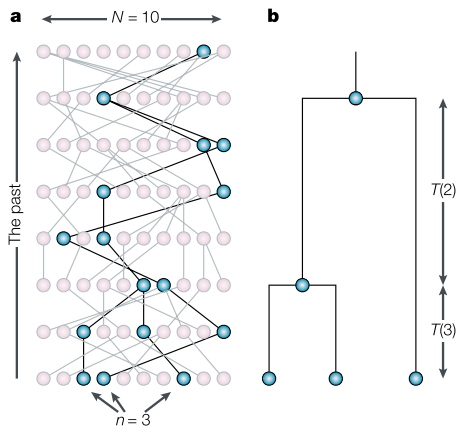

The coalescent approximation is based on the following insights:

- Populations are large and only some k lineages are viewed; the
  probability that more than two lineages coalesce at the same time can
  be neglected
- the process of generating a topology can be separated from generating
  the branch length, i.e.: first a random topology can be generated and
  than random branch length (exponential distribution) can be drawn.

**major advantage of coalescent approximation: very fast**

## Topology

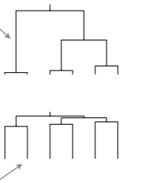

## Prerequisite: Trees

The R library ape supports printing trees in the Newick format
(<https://en.wikipedia.org/wiki/Newick_format>)

Simplest tree

``` r
library(ape)
tree <- read.tree(text="(A:2,B:2);")
plot(tree)
```

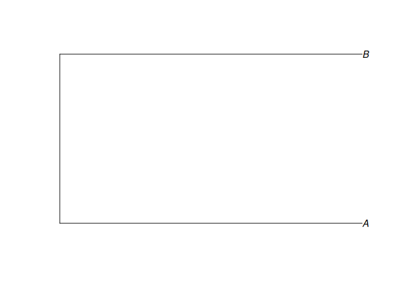<!-- -->

A bit more complex tree

``` r
tree <- read.tree(text="((A:2,B:2):3,C:5);")
plot(tree)
```

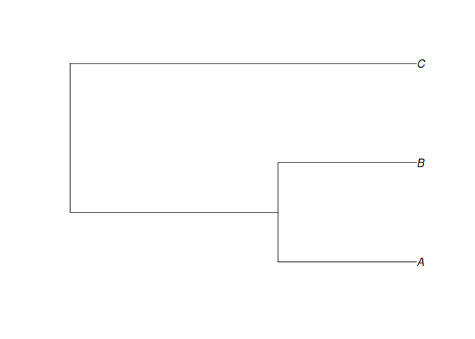<!-- -->

``` r
tree <- read.tree(text="(((A:2,B:2):3,C:5):15,D:20);")
plot(tree)
```

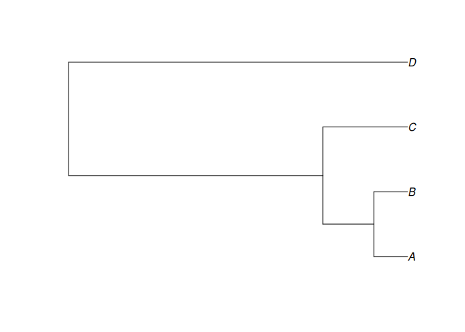<!-- -->

Adding a time axis

``` r
tree <- read.tree(text="(((A:2,B:2):3,C:5):15,D:20);")
plot(tree)
axisPhylo()
```

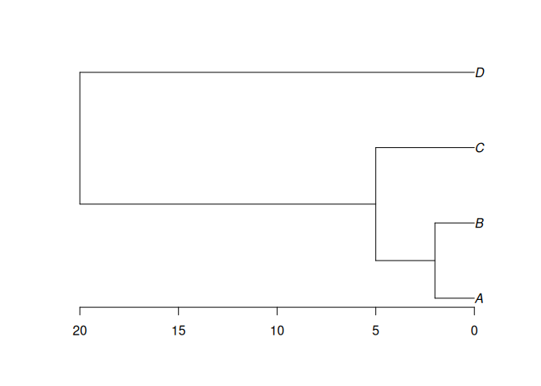<!-- --> In
ape a tree is a list. the most important elements of the list are

``` r
tree <- read.tree(text="(((A:2,B:2):3,C:5):15,D:20);")
tree$tip.label # names of tips
```

    ## [1] "A" "B" "C" "D"

``` r
tree$edge 
```

    ##      [,1] [,2]
    ## [1,]    5    6
    ## [2,]    6    7
    ## [3,]    7    1
    ## [4,]    7    2
    ## [5,]    6    3
    ## [6,]    5    4

``` r
# branches; each row connects a parent node to a child
# Tips are numbered 1 … n, internal nodes n+1 … . Let's add the numbers to the plot: 
tree$edge.length # the length of the branches
```

    ## [1] 15  3  2  2  5 20

lets add numbers to the plot

``` r
plot(tree)
nodelabels()
tiplabels()
edgelabels(tree$edge.length)
```

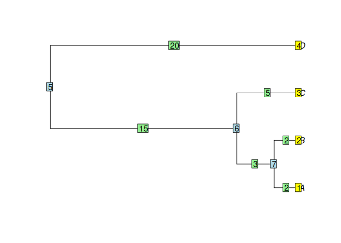<!-- --> \##
writing trees to files; reading trees from files

``` r
write.tree(tree,file="test.nwk")
getwd() # ok where did it save the tree?
```

    ## [1] "/home/robert/gh/PopGenLecture/Coalescent"

``` r
tr2<-read.tree("test.nwk")
plot(tr2)
```

<!-- -->

### Excercises

#### build the following trees

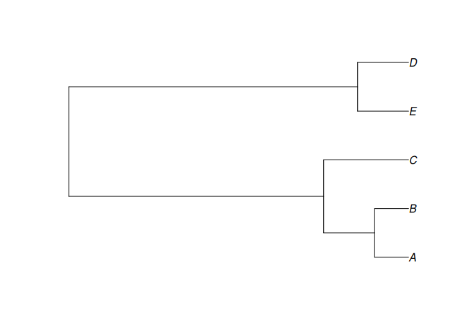<!-- -->

#### build the tree

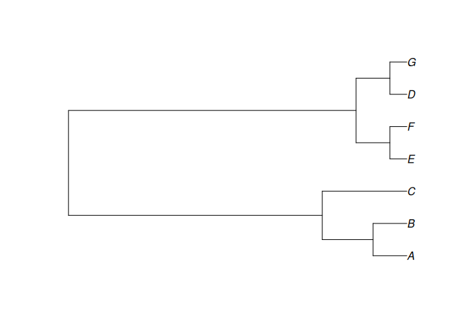<!-- -->

#### change the branchlength and use the function is.ultrametric()

What is an ultrametric tree?

``` r
is.ultrametric(tree)
```

    ## [1] TRUE

# coalescent trees with ape

## random tree

``` r
tr <- rcoal(10) # rcoal gives me a random tree
plot(tr);
axisPhylo()
```

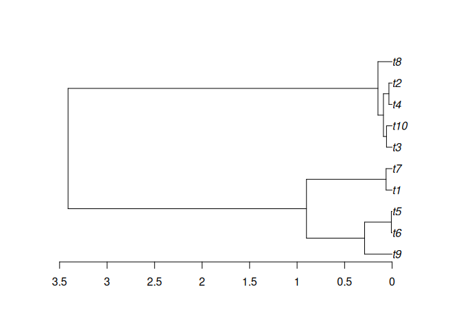<!-- --> \##
the SFS for a single tree We could compute the expected SFS for every
tree, eg if we perform infinite many simulations and random mutations.
Much simpler lets assume infinite sites and infinite mutations; this
removes the stochasticity of mutations;\
We can compute the exact SFS for every tree (e.g using infinite many
mutations. ) We sum the length of all branches leading to singletons;
the sum of all branches leading to doubletons etc

``` r
branch_sfs <- function(tree) {
  n <- Ntip(tree)

  # number of tips below every node (a tip counts as 1, the root as n)
  # exercise: try it with a random tree; use nodelabels() and tiplabels()
  tips_below_node <- node.depth(tree, method = 1)

  # tree$edge = all branches
  # tree$edge= all child nodes (node below each parent)
  child_node <- tree$edge[, 2]

  # number of tips below each branch (actually below each child)
  # 1 ... singletons; every mutation on this branch is a singleton
  # 2 ... doubletons; every mutation on this branch is a doubleton
  tips_below_branch <- tips_below_node[child_node]

  # total branch length for each class: 1, 2, ..., n-1 tips below
  sfs <- numeric(n - 1)
  for (i in 1:(n - 1)) {
    is_class_i <- tips_below_branch == i ## which branches lead to singletons, doubletons etc (dependent on i)
    sfs[i] <- sum(tree$edge.length[is_class_i]) ## sum all branches leading to singletons doubletons (etc)
  }

  names(sfs) <- 1:(n - 1)
  sfs
}
tr <- rcoal(10)
par(mfrow = c(1, 2))
plot(tr)
barplot(branch_sfs(tr), xlab = "derived allele count", ylab = "branch length")
```

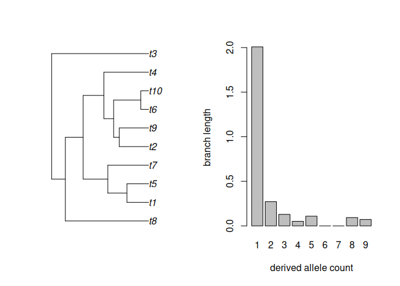<!-- -->

``` r
par(mfrow = c(1, 1))
```

## average SFS over many trees

``` r
trees <- replicate(5000, branch_sfs(rcoal(10))) # lets simulate 5000 trees and compute the SFS
avg <- rowMeans(trees) # average the branch lengths (the SFS)
bp  <- barplot(avg, xlab = "derived allele count i", ylab = "mean branch length")
```

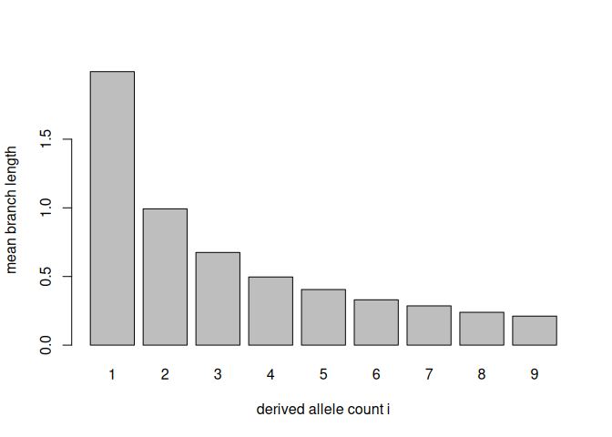<!-- -->

# scrm

Coalescent simulations

Setting up

``` r
library(scrm)
set.seed(42)
```

how to call:

    scrm("nsam nreps -t theta [other options]")

- nsam: number of DNA sequences
- nreps: how often should the simulations be repeated for the given set
  of parameters
- theta: amount of polymorphism $\theta=4N_e\mu$; Interestingly, we
  would get the same amount of polymorphism by either increasing the
  mutation rate or the effective population size.

Why Theta?

## Minimal call

``` r
sim <- scrm("10 1 -t 5") 
# we sampled 10 sequences
# 1 replicate
# Theta is 5
sim
```

    ## $seg_sites
    ## $seg_sites[[1]]
    ##       0.648103177771108 0.805250268091008
    ##  [1,]                 0                 0
    ##  [2,]                 0                 0
    ##  [3,]                 0                 0
    ##  [4,]                 0                 0
    ##  [5,]                 1                 0
    ##  [6,]                 0                 1
    ##  [7,]                 1                 0
    ##  [8,]                 0                 0
    ##  [9,]                 0                 0
    ## [10,]                 1                 0

### the SFS of seg_sites

``` r
sfs <- function(seg) {
  n <- nrow(seg)                       # number of samples (rows = haplotypes)

  # derived allele count at each segregating site (columns = sites)
  derived_count <- colSums(seg)

  # just count 
  counts <- tabulate(derived_count, nbins = n - 1)
  names(counts) <- 1:(n - 1)
  return(counts)
}
s<-sfs(sim$seg_sites[[1]])
barplot(s, xlab = "derived allele count", ylab = "number of sites")
```

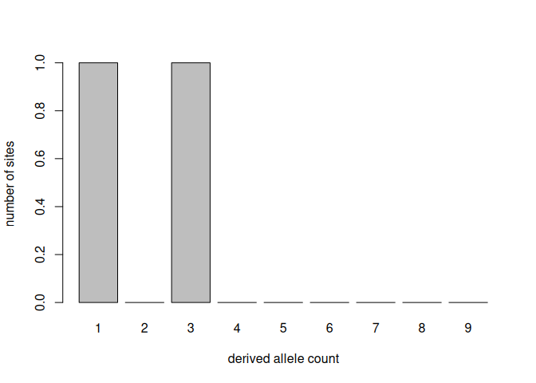<!-- -->

## Lets add a tree

``` r
sim <- scrm("10 1 -t 5 -T") 
tree <- read.tree(text = sim$trees[[1]])
plot(tr); 
axisPhylo()
```

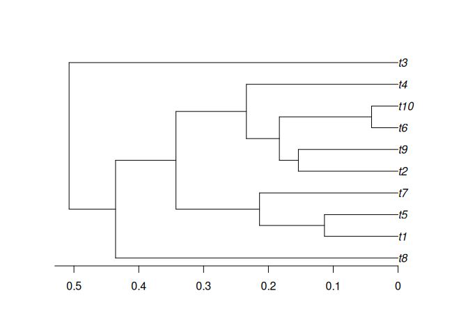<!-- -->
\### Idea! We could plot the expected SFS from the tree versus the
actual SFS

``` r
par(mfrow = c(1, 3))
plot(tr)
barplot(branch_sfs(tr), xlab = "derived allele count", ylab = "branch length")
barplot(sfs(sim$seg_sites[[1]]),       xlab = "derived allele count", ylab = "number of sites")
```

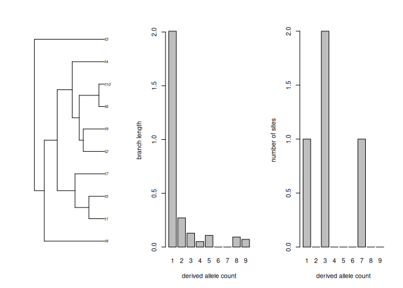<!-- -->

``` r
par(mfrow = c(1, 1))
```

**Question** why does it differ?

## plotting a tree

``` bash
cd /Users/robertkofler/iprof/lectures/PopGenExercises/msms
# get a tree using -T
# Question: does -t 5 have an influence on the shape of the tree
java -jar msms.jar 10 1 -t 5 -T
```

``` r
# print the tree by copy and pasting into R..
# for example
tree<-"(3:1.76266,((4:0.25100,10:0.25100):0.19867,(((5:0.00991,2:0.00991):0.13773,7:0.14764):0.23604,(9:0.19889,(1:0.13684,(6:0.02352,8:0.02352):0.11332):0.06204):0.18479):0.06599):1.31299);"
plot(read.tree(text=tree))
```

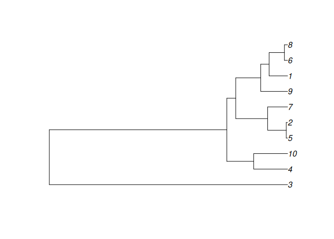<!-- -->

this is a standard tree for the most boring case

## Influence of demography

### Growing population

``` bash
# growth -G growthRate_alpha
java -jar msms.jar 10 1 -t 5 -T -G 1.5
```

- $N=Ne^{-\alpha t}$
- alpha positive expanding
- alpha negative shrinking

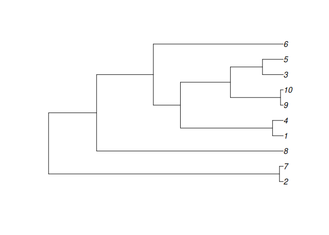<!-- -->

- Whats the difference?
- How is the expected pattern of polymorphism changing?
- Where do you expect more singletons?

### Shrinking population

``` bash
java -jar msms.jar 10 1 -t 5 -T -G -2
```

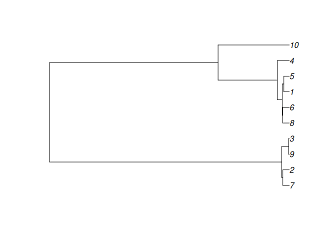<!-- -->

- Whats the difference?
- How is the expected pattern of polymorphism changing?
- Where do you expect more singletons?

### Bottleneck

``` bash
java -jar msms.jar 10 1 -t 5 -T -I 1 10 -en 0.2 1 0.3 -en 0.4 1 1.0
```

Questions and tasks

- -I demes samples
- -en bottlenecktime demenumber fraction_popsize
- -en 0.2 1 0.3 bottleneck starting at time 0.2; size = 30% of original
  population
- -en 0.4 1 1.0 end of bottleneck at time 0.4
- Play with different bottleneck times and sizes

``` r
tree="((((2:0.00689,5:0.00689):0.05246,1:0.05936):0.13163,(7:0.07542,4:0.07542):0.11557):1.72711,(6:0.10136,(8:0.09976,((3:0.01124,9:0.01124):0.02080,10:0.03204):0.06771):0.00160):1.81675);"
plot(read.tree(text=tree))
```

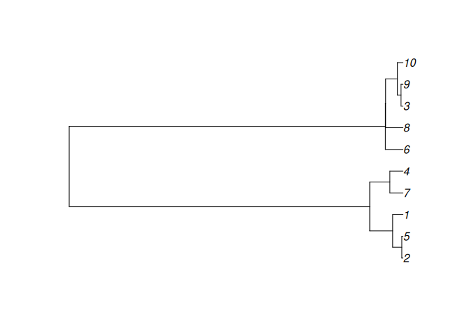<!-- -->

#### Planning bottlenecks / complex demographies with msms

``` bash
# open PopPlaner
java -jar PopPlanner.jar
```


## Recombination

``` bash
java -jar msms.jar 10 1 -t 5 -T -r 2
```

``` r
tree="(4:0.46329,(((3:0.14568,(5:0.00400,2:0.00400):0.14168):0.11708,10:0.26276):0.09154,((8:0.02699,1:0.02699):0.30651,((7:0.04412,6:0.04412):0.04440,9:0.08853):0.24497):0.02080):0.10899);
(((3:0.14568,(5:0.00400,2:0.00400):0.14168):0.11708,10:0.26276):0.09154,((8:0.02699,1:0.02699):0.30651,(4:0.23129,((7:0.04412,6:0.04412):0.04440,9:0.08853):0.14276):0.10221):0.02080);
((((9:0.08743,3:0.08743):0.05825,(5:0.00400,2:0.00400):0.14168):0.11708,10:0.26276):0.09154,((8:0.02699,1:0.02699):0.30651,(4:0.23129,(7:0.04412,6:0.04412):0.18716):0.10221):0.02080);
"
plot(read.tree(text=tree))
```

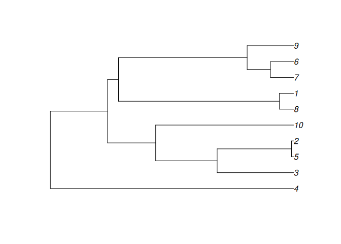<!-- -->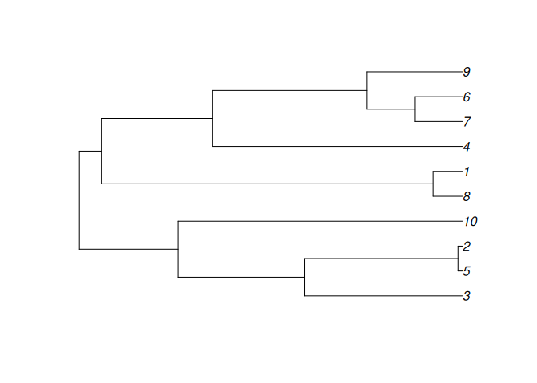<!-- -->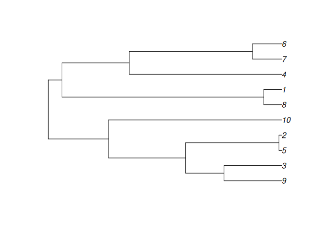<!-- -->

\*\* Whats going on, why do we have sevarl trees? \*\*


## Migration

``` bash
java -jar msms.jar 10 1 -t 5 -T -I 2 5 5 0.05
```

- -I demes samples-deme1 samples-deme2 migration-rate

``` r
tree="((6:1.50432,((10:0.16282,(9:0.06539,7:0.06539):0.09744):0.17220,8:0.33502):1.16930):33.76309,((1:0.06373,3:0.06373):0.52764,(2:0.06538,(5:0.06511,4:0.06511):0.00027):0.52600):34.67603);"
plot(read.tree(text=tree))
```

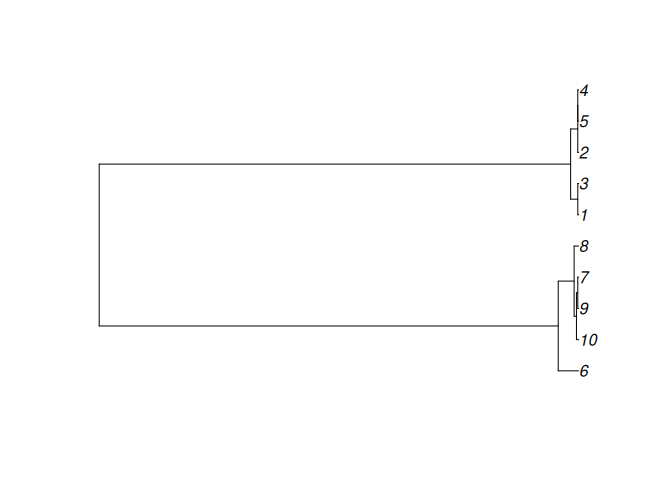<!-- -->

Questions and tasks:

- What could be the major factor influencing coalescent with 2 or more
  demes
- How would the pattern of polymorphism look in this case
- Play with different demes and migration rates

## Selection

``` r
java -jar msms.jar 10 1 -t 5 -r 500 20 -SAA 2000 -SaA 1000 -N 10000 -SF 0 -Sp .5
```

- -r recombinationrate recombinationsites
- -SAA selection coefficient of homozygous beneficial genotype
- -SAa selection coefficient of heterozygous allele
- -N population size
- -SF time since fixation
- -Sp position of selected allele on a scale from 0 to 1. In case of 0.5
  selected allele is at the middle of the simulated loci

``` bash
java -jar msms.jar 10 1 -t 5 -T -SAA 300 -SaA 200 -N 10000 -SF 0 -Sp .5
```

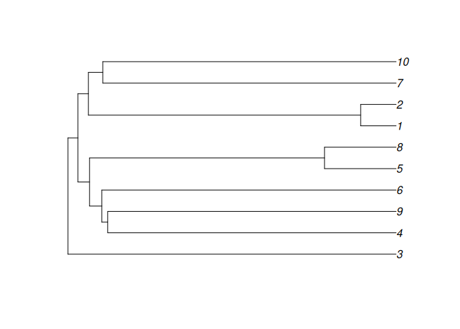<!-- -->

**How is this site frequency spectrum going to look like?**

### Excersises

Start MSMSPlay

``` bash
java -cp $msp at.mabs.gui.MSMSPlay -ms 20 1000 -t 100 -r 50 20
```


/clearpage

Excersises:

- compute the site frequency spectrum of a simple neutral coalescent (20
  sites); whats the influence of theta?
- compare it to a site frequency spectrum using a scenary with selection
  (eg.: -ms 20 1000 -t 100 -r 500 20 -SAA 2000 -SaA 1000 -N 10000 -SF 0
  -Sp .5)
- whats the difference between a selection scenario with and without
  recombination?
- whats the influence of SF and the position of the selected site?
- can you mimic the signature of selection using bottlenecks?
- can you mimic the signature of selection using a migration scenario?
